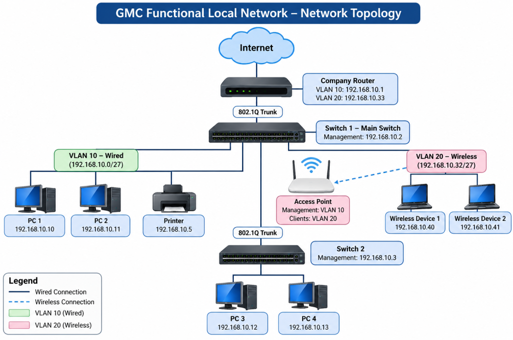
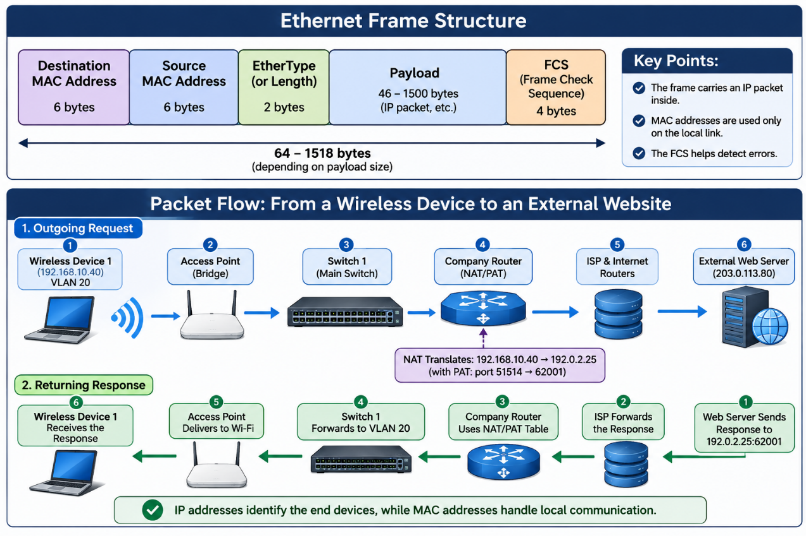
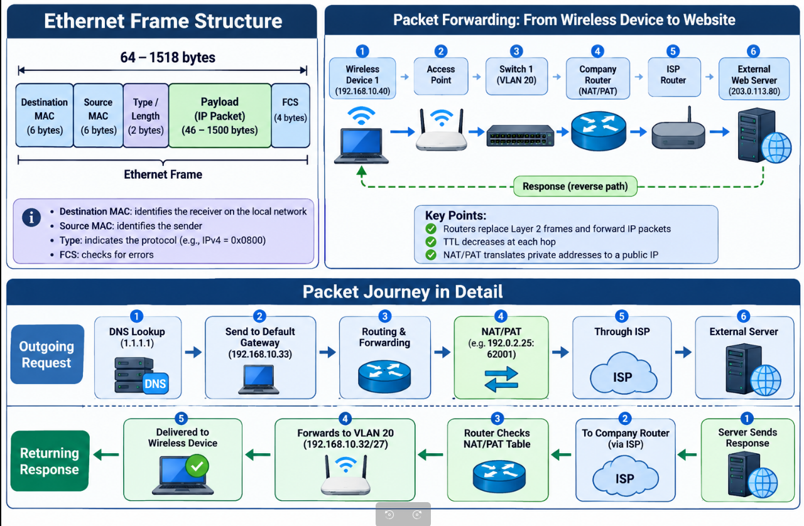

# Functional Local Network Design and Analysis

## Project Overview

This project presents the design and analysis of a small company local area network (LAN) with Internet connectivity.

The proposed network includes:

- 1 Internet-connected router
- 2 managed switches
- 4 employee computers
- 1 network printer
- 1 wireless access point
- 2 wireless client devices

The project explores how devices communicate across a LAN and how data travels between local devices and external networks.

## Network Architecture

The proposed network uses a hierarchical star topology.

The main router connects the company network to the Internet. Switch 1 acts as the central switch and connects to Switch 2, the printer, two employee computers, and the wireless access point. Switch 2 connects the remaining two employee computers.

The wireless access point provides connectivity to two wireless devices.

The design uses two VLANs:

| VLAN    | Purpose                                     | Network            |
| ------- | ------------------------------------------- | ------------------ |
| VLAN 10 | Wired devices and infrastructure management | `192.168.10.0/27`  |
| VLAN 20 | Wireless clients                            | `192.168.10.32/27` |

The router provides the default gateways, DHCP services, inter-VLAN routing, and NAT/PAT for Internet access.

## Checkpoint Parts

### Part 1 – MAC Addresses and Frame Handling

Documentation: [MAC and Frame Handling](docs/mac-frame-handling.md)

Topics covered:

- MAC addressing
- ARP and address resolution
- Switch MAC address learning
- Ethernet frame structure
- Ethernet collision handling using CSMA/CD
- Wi-Fi collision avoidance using CSMA/CA

### Part 2 – IP Addressing and Subnetting

Documentation: [IP Addressing](docs/ip-addressing.md)

Topics covered:

- Private IPv4 addressing
- Subnetting using `/27` networks
- VLAN separation
- Device IP address allocation
- Default gateways
- DHCP and the DORA process

### Part 3 – Routing and Packet Forwarding

Documentation: [Routing and Packet Forwarding](docs/routing-and-packet-forwarding.md)

Topics covered:

- Wireless-to-Internet communication
- IPv4 packet structure
- Router forwarding decisions
- Longest Prefix Match
- TTL handling
- Network Address Translation (NAT)
- Port Address Translation (PAT)
- Return traffic forwarding

## Practical Network Investigation

Documentation: [Practical Network Observations](docs/lab-observations.md)

A practical investigation was conducted using Ubuntu Linux networking tools.

Commands included:

- `ip -br address`
- `ip route`
- `ping`
- `getent`
- `curl`
- `tracepath`
- `ip neigh`

The investigation demonstrated IP configuration, routing, Internet connectivity, DNS resolution, HTTPS communication, route discovery, and MAC address resolution.

**Note:** Practical observations were collected on an existing Wi-Fi network and are separate from the hypothetical company LAN design.

## Diagrams

The project includes three diagrams illustrating the proposed network and its communication processes.

### 1. Network Topology

Shows the complete LAN architecture, including the router, two switches, four employee PCs, printer, wireless access point, and wireless devices.

### 2. Ethernet Frame Structure

Illustrates the fields of an Ethernet II frame, their order, and their sizes.

### 3. Packet Forwarding Flow

Shows how a wireless device communicates with an external web server through the access point, switches, router, and ISP, including NAT/PAT.

## Technologies and Tools

- IPv4
- Ethernet
- Wi-Fi
- VLANs
- DHCP
- ARP
- DNS
- ICMP
- NAT/PAT
- Ubuntu Linux networking utilities
- Git and GitHub

## Conclusion

This project combines network design principles with practical observations to explain how devices communicate within a LAN and access external networks.

It demonstrates the roles of the data link and network layers, the importance of IP and MAC addressing, and how routers forward packets between networks.
